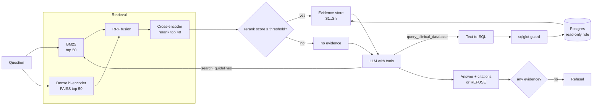

# Clinical Guideline RAG Assistant

A retrieval-augmented assistant that answers clinicians' questions from a corpus of 1,200
clinical practice guidelines (WHO, NICE, CDC, CMA, SPOR, CCO, ICRC; 47K passages), with a
text-to-SQL tool over a structured Postgres layer and an evaluation harness built on RAGAS,
LangSmith and MLflow.

- **Hybrid retrieval**: BM25 + dense bi-encoder (FAISS) fused with Reciprocal Rank Fusion,
  then reranked by a cross-encoder. Every stage is a selectable `mode`, so the ablation
  measures the production code path.
- **Text-to-SQL tool** over Postgres (guidelines, graded recommendations, drug dosing,
  diagnostic thresholds) with an AST-level SQL guard, a read-only DB role, statement
  timeouts and execution-guided self-correction.
- **Grounded answers**: numbered evidence (`[S1]`, `[DB1]`), inline citations, an explicit
  refusal protocol, and an evidence gate that refuses when nothing relevant was retrieved,
  independently of the prompt.
- **Evaluation harness**: 100-question set (in-corpus, SQL, adversarial, out-of-scope) with
  774 pooled relevance judgments; Recall@k / Hit@k / MRR / nDCG retrieval ablation across 4
  retrieval modes at guideline and passage level; RAGAS faithfulness, answer relevancy,
  context precision/recall; refusal and false-refusal rates. Every run is logged to MLflow,
  and every answer is traced in LangSmith with its RAGAS scores attached as feedback.
- **Versioned prompts** (`prompts/v1..v4`), each with the hypothesis behind the change and
  a content hash logged with every eval run.

> Research/engineering project. Not a medical device and not medical advice.

## Architecture



## Repository layout

```
src/clinrag/
  ingestion/     loaders (PDF/HTML/MD/JSONL), section-aware chunker, titles for untitled docs
  retrieval/     tokenizer, BM25, dense (FAISS), RRF, cross-encoder, HybridRetriever
  sql/           schema context, SQL guard, text-to-SQL, Postgres helpers, LLM extraction
  agent/         prompt loader, tools + evidence store, refusal detection, assistant loop
  evaluation/    dataset schema, ranking metrics, RAGAS scoring, retrieval ablation,
                 RAG eval, MLflow/LangSmith tracking, testset builder
  api/           FastAPI service + single-file chat page (static/index.html)
  cli.py         `clinrag` command
prompts/         v1_baseline -> v2_citations -> v3_grounded_refusal -> v4_claim_check
sql/             schema + read-only role (applied by docker compose on first start)
scripts/         download_guidelines.py (open-access corpus from the HF Hub)
data/            corpus, indexes, structured CSVs, eval set (see data/README.md)
tests/           offline unit tests (fake embedder / reranker / LLM, SQLite)
```

## Quickstart

```bash
python -m venv .venv && source .venv/bin/activate
pip install -e ".[all]"            # models + eval + data + dev extras
cp .env.example .env               # add OPENAI_API_KEY and LANGSMITH_API_KEY
docker compose up -d postgres mlflow
```

1. **Corpus** - put guidelines in `data/raw/` or pull an open-access sample:
   ```bash
   python scripts/download_guidelines.py --n 1200
   ```
   That dump has no titles for most non-NICE guidelines. Have the LLM write descriptive
   titles from each document's headings and opening text (~48 calls; checked against
   the text and marked as generated), as described in [data/README.md](data/README.md):
   ```bash
   clinrag metadata titles --limit 20 && clinrag metadata report   # pilot
   clinrag metadata titles && clinrag metadata apply
   ```
2. **Ingest and index**
   ```bash
   clinrag ingest        # -> data/processed/{documents,chunks}.jsonl
   clinrag index         # -> data/indexes/ (BM25 + FAISS)
   ```
3. **Structured layer**
   ```bash
   clinrag db init       # schema + read-only role (no-op if compose already did it)
   clinrag db extract    # optional: LLM-extract doses/thresholds/recommendations to CSV
   clinrag db load       # guidelines table from corpus metadata + data/structured/*.csv
   ```
4. **Use it**
   ```bash
   clinrag search "management of postpartum haemorrhage" --mode hybrid_rerank
   clinrag ask "What dose of oxytocin plus ergometrine is recommended to prevent postpartum haemorrhage?"
   clinrag db query "How many NICE guidelines are in the corpus?"
   clinrag serve         # chat page at http://127.0.0.1:8000 (+ /ask /search /prompts /health)
   ```

   The **chat page** shows each answer with clickable citations (`[S1]` opens the exact
   passage the model was given; database answers show the SQL and the result table), a
   badge when the assistant declines, the extra searches or database queries it made, and
   the response time. Citations to evidence the model was never shown are flagged in red.
   Pick a prompt version (v1-v4) to compare their behaviour on the same question.

`data/README.md` describes every input file and its format.

## Evaluation

```bash
clinrag eval build-testset           # draft 100 questions -> data/eval/eval_set.draft.jsonl
# review the draft, save as data/eval/eval_set.jsonl
clinrag eval summary                 # validate + composition
clinrag eval sync-langsmith          # upload as a LangSmith dataset

clinrag eval retrieval               # bm25 / dense / hybrid / hybrid_rerank ablation
clinrag eval retrieval --dataset data/eval/eval_set.reworded.jsonl --level chunk
clinrag eval rag --prompt v1 --prompt v2 --prompt v3 --prompt v4
clinrag eval compare                 # table of MLflow runs
```

MLflow UI: http://localhost:5000 - experiments `clinrag-retrieval` and `clinrag-rag-eval`.

The committed set (`data/eval/eval_set.jsonl`) was drafted by the LLM and reviewed by hand;
`eval_set.reworded.jsonl` rewrites its in-corpus questions the way a clinician would type
them, and the relevance labels were completed by pooled judging. See
[data/README.md](data/README.md#the-committed-set) for how each was made.

**Eval set composition** (100 questions)

| category | expected | n | purpose |
|---|---|---|---|
| in_corpus | answer | 60 | answerable from guideline text; labelled with relevant guideline ids |
| sql | answer | 8 | answerable from the structured tables |
| adversarial | answer | 8 | false premises the evidence contradicts |
| adversarial | refuse | 4 | prompt injection |
| out_of_scope | refuse | 20 | topics absent from the corpus, off-topic, personal medical advice |

**Metrics**

- *Retrieval* (`in_corpus` questions; `--level doc` for guidelines, `--level chunk` for
  passages): Recall@k = share of the relevant guidelines or passages found in the top-k
  results the model would see; Hit@k = at least one relevant result in the top k; MRR =
  average 1/rank of the first relevant result; nDCG@k. Relevance labels are the source
  passage plus pooled judgments, so passages from other guidelines that also answer the
  question count as hits.
- *Answer quality* (RAGAS 0.4, LLM judge): faithfulness against exactly the evidence shown
  to the model, answer relevancy, context precision and recall against the reference answer.
  Every answered response is judged, including ones that should have been refused, so
  hallucinating an out-of-corpus answer lowers faithfulness.
- *Behaviour*: `refusal_rate_out_of_corpus`, `false_refusal_rate`, `adversarial_pass_rate`,
  `behavior_accuracy`, share of refusals made by the evidence gate, uncited-answer rate.

Per-question records (answer, contexts, citations, scores, LangSmith run id) are written
to `outputs/` and logged to MLflow as artifacts and a table.

## Results

### Retrieval

60 in-corpus questions from `eval_set.reworded.jsonl`, passage level (`--level chunk`),
pooled relevance labels; logged to MLflow (`clinrag eval compare --experiment retrieval`).
Hit@1 is the share of questions whose first result answers them.

| Retrieval mode | Recall@5 | MRR | nDCG@5 | Hit@1 | Median latency |
|---|---|---|---|---|---|
| BM25 | 0.704 | 0.731 | 0.644 | 0.633 | 180 ms |
| Dense | 0.768 | 0.842 | 0.759 | 0.783 | 178 ms |
| Hybrid (RRF) | 0.746 | 0.836 | 0.738 | 0.750 | 177 ms |
| Hybrid + rerank | **0.799** | **0.868** | **0.792** | **0.817** | 342 ms |

- Hybrid + rerank vs BM25: Recall@5 +0.10, MRR +0.14, Hit@1 +0.18, each significant
  (paired bootstrap over questions, 10,000 resamples, 95% interval excludes zero).
  Hybrid + rerank vs plain hybrid is not significant on 60 questions.
- Guideline level (`--level doc`, same questions): Recall@5 0.916 → 0.963 and MRR
  0.880 → 0.966 from BM25 to hybrid (significant); the reranker adds no further gain here.
- With the original question wording (`eval_set.jsonl`, passage level), every mode scores
  higher (MRR 0.879 for BM25, 0.947 for hybrid + rerank): questions that reuse the source
  passage's words are easier, especially for keyword search.
- Latency is per query on one consumer GPU (RTX 5070 Ti), retrieval only.

### Answer quality

Filled in from `clinrag eval compare` after running `clinrag eval rag` for each prompt.

| Prompt | Faithfulness | Answer relevancy | Out-of-corpus refusal | False refusal |
|---|---|---|---|---|
| v1 baseline | | | | |
| v2 citations | | | | |
| v3 grounded + refusal | | | | |
| v4 claim check | | | | |

## Design notes

- **Contextual chunk headers.** Each chunk is indexed as `title > section path` + text, so
  queries naming a guideline or topic match passages that don't repeat those words.
- **Section-aware chunking** never crosses a section boundary, overlaps by whole sentences,
  and keeps page ranges for citations.
- **RRF instead of score blending.** BM25 scores are unbounded and cosine scores are not,
  so fusion uses ranks only; no per-corpus normalisation to tune.
- **Calibrated refusal threshold.** Cross-encoder scores are mapped to [0, 1]; passages
  below `REFUSAL_SCORE_THRESHOLD` are not shown to the model. Tune it on the eval set by
  trading `refusal_rate_out_of_corpus` against `false_refusal_rate`.
- **SQL safety in depth.** sqlglot AST checks (single SELECT, allow-listed tables, no
  system functions, LIMIT cap) + a `default_transaction_read_only` role + per-statement
  timeout. The model sees DB errors and empty results and gets to retry.
- **Reproducible evals.** Every run logs prompt version + content hash, dataset hash,
  models and retrieval knobs, so any number in the results table traces back to an exact
  configuration.

## Configuration

All settings are environment variables (see `.env.example` and `src/clinrag/config.py`).
Key ones: `LLM_MODEL`, `EMBEDDING_MODEL` (default `BAAI/bge-base-en-v1.5`),
`RERANKER_MODEL` (default `BAAI/bge-reranker-base`), `FINAL_TOP_K`, `RERANK_CANDIDATES`,
`REFUSAL_SCORE_THRESHOLD`, `PROMPT_VERSION`, `EVAL_JUDGE_MODEL`, `MLFLOW_TRACKING_URI`,
`LANGSMITH_TRACING`. Any OpenAI-compatible endpoint works via `OPENAI_BASE_URL`.

### Running on Google Gemini (free tier)

`.env.example` is set up for Gemini's OpenAI-compatible endpoint with an AI Studio key.
Things to know:

- **Thought signatures.** Gemini 3+ attaches a signature to every tool call and rejects the
  next request (HTTP 400) unless it is sent back. The client keeps these provider fields
  and returns them with the assistant turn automatically.
- **Thinking tokens.** `max_tokens` covers thinking and the answer, so keep
  `LLM_MAX_TOKENS` and `EVAL_JUDGE_MAX_TOKENS` around 4096. Google advises a temperature of
  1.0 for Gemini 3+, so no call site hard-codes a temperature.
- **Quotas.** Per-minute limits return HTTP 429 and "model overloaded" returns HTTP 503;
  the client waits and retries (`LLM_MAX_RETRIES`, back-off 4 s → 60 s). Per-day limits fail
  immediately. Quotas are per model, and full Flash models allow far fewer requests per day
  on the free tier than Flash-Lite. For evals, run one prompt version at a time with
  `--workers 1`, `EVAL_CONCURRENCY=1` and, if needed, `--metrics faithfulness` (about a
  quarter of the judge calls).
- **Judge model.** `EVAL_JUDGE_MODEL` (`gemini-3.1-flash-lite` in `.env.example`) is a
  different model from `LLM_MODEL`, so the judge never grades its own answers, and it gets
  its own quota.
- If an endpoint rejects JSON mode (`response_format`), the client falls back to plain JSON
  prompts and parses the reply tolerantly.

## Development

```bash
pip install -e ".[dev]"
pytest          # offline: fake embedder/reranker/LLM, SQLite
ruff check src tests scripts && ruff format --check src tests scripts
```

## License

MIT
